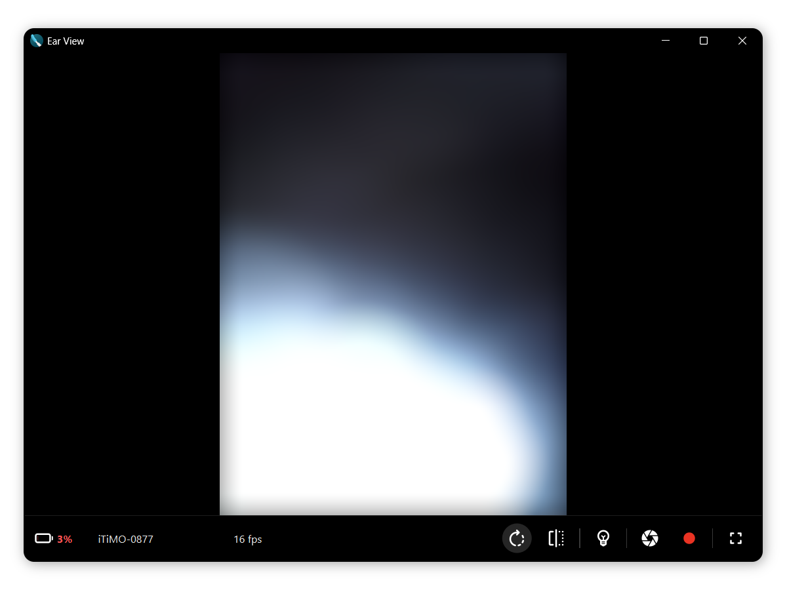

<p align="center">
    
    <h1 align="center">Ear View</h1>
</p>

<p align="center">A fast, minimal live view for iTiMO / MZ / Soulear Wi-Fi otoscopes — on Android and on your desktop.
</p>




Ear View connects directly to the camera's Wi-Fi access point and gives you a clean full-screen picture with battery level, rotation, mirroring, screenshots and video recording. Under 100 KB Android app size, also supports Windows, Linux and macOS.

## Download

| Platform | Requirements | Download |
| --- | --- | --- |
| **Android** | Android 11 or newer | [**EarView-Android.apk**](https://github.com/fordownloads/EarView/releases/latest/download/EarView-Android.apk) |
| **Windows** | Windows 10/11, 64-bit | [**EarView-Windows-amd64.zip**](https://github.com/fordownloads/EarView/releases/latest/download/EarView-Windows-amd64.zip) |
| **Other OS** | Python 3.10+ with PySide6 | [**Download repo**](https://codeload.github.com/fordownloads/EarView/zip/refs/heads/master)* |

\* install requirements.txt and launch desktop-app/viewer.py

### Android

Download and install app. Launch **Ear View**, power on the otoscope and join its Wi-Fi network through **Select device** button. Tap **Retry** if stream won't appear.

> Recording and screenshots not supported

### Windows

Download and extract the archive. Run `Ear View.exe`, power on the otoscope and join its Wi-Fi network through **Select device** button. Tap **Retry** if stream won't appear.

> Recording uses `ffmpeg`. If it is not on your `PATH` or in the same folder as `Ear View.exe`, live view still works but you can't record.

## Features

- iTiMO (`192.168.10.123`) and Soulear (`192.168.1.1`) protocols support
- LED lamp on/off, 90° rotation and mirror
- Snapshot capture to PNG and video recording to MP4 (desktop)
- Full-screen viewing, minimal on-screen controls
- Tiny download (< 100 KB), no ads, no telemetry, fast stream processing
- Use gestures to rotate and mirror screen (android)

### Desktop controls

Full screen: `F11` or `Alt+Enter`, exit with `Esc`

## Other platforms & building from source

The desktop app is currently packaged and tested for Windows only. macOS/Linux support is not provided; Android is the supported mobile platform.

**Android from source**

```bash
./gradlew assembleRelease
# APK: app/release/app-release.apk
```

Requires JDK 17 and the Android SDK (compile SDK 35). `minSdk` is 30.

**Desktop app from source**

```bash
cd desktop-app
python3 -m pip install -r requirements.txt
python3 viewer.py
```

Python 3.10+ is required. Optional arguments: `--host <ip>`, `--backend auto|itimo|soulear`, `--local-ip <ip>` when several adapters share the camera's subnet.

To build the Windows executable:

```bash
python -m pip install pyinstaller pillow
python build_exe.py       # output: desktop-app/dist/Ear View/Ear View.exe
```


## Disclaimer

>This project may not support your device model. Feel free to decompile your vendor app with DeepSeek or other AI and add support of your otoscope into this repository